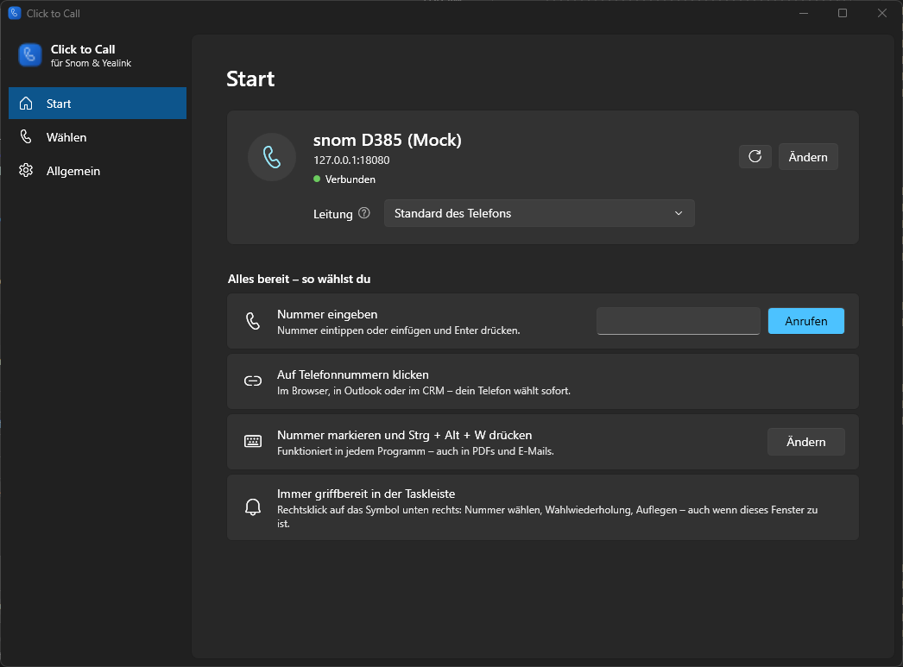
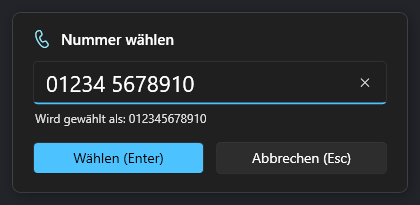
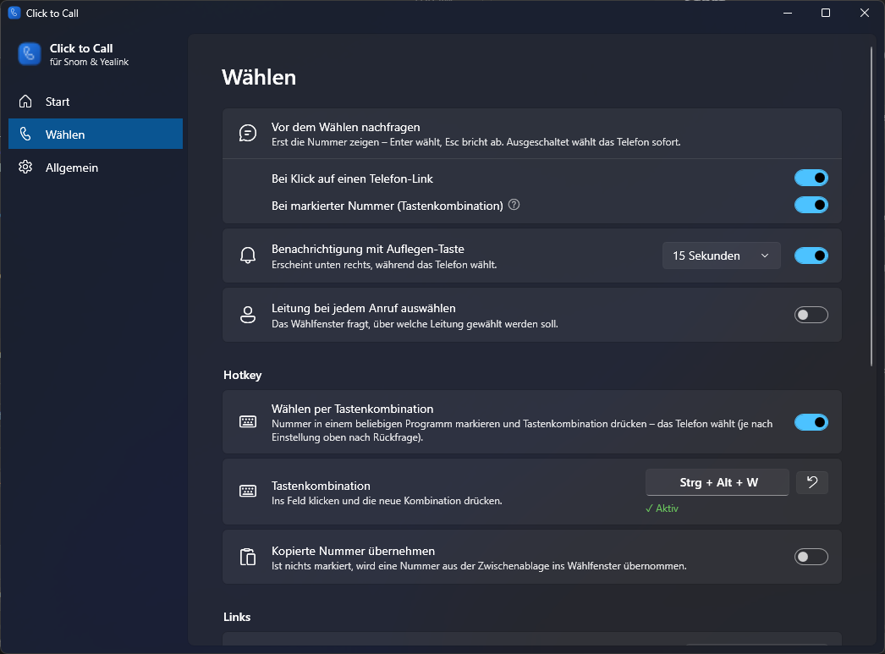
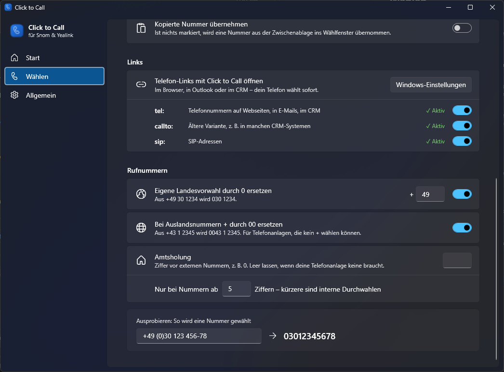

# Click to Call

Wählt Telefonnummern vom Windows-PC aus auf einem Snom- oder Yealink-Tischtelefon – per Klick auf `tel:`-Links oder per Tastenkombination für markierte Nummern in jedem Programm.

Die App steuert das Telefon direkt über dessen Web-Schnittstelle im lokalen Netzwerk. Eine Telefonanlagen-Software oder ein Server ist nicht nötig.



## Funktionen

- 📞 `tel:`-, `callto:`- und `sip:`-Links öffnen am Telefon (Browser, Outlook, CRM …)
- ⌨️ Nummer markieren und <kbd>Strg</kbd>+<kbd>Alt</kbd>+<kbd>W</kbd> drücken – funktioniert auch in PDFs und E-Mails
- Rufnummern werden aufbereitet: `+49 (0)30 123 456-78` → `03012345678`, optional mit Amtsholung
- Rückfrage vor dem Wählen, Auflegen-Taste, Wahlwiederholung, Auswahl der Leitung
- Findet das Telefon selbst im Netzwerk
- Läuft im Infobereich der Taskleiste, Updates per Klick
- Deutsch und Englisch



## Unterstützte Telefone

| Hersteller | Serien | Modelle (Beispiele) |
|---|---|---|
| **Snom** | D3xx, D7xx | D305, D315, D335, D345, D385, D713, D715, D717, D735, D785 |
| **Yealink** | T3x, T4x, T5x | T31, T33, T42, T43, T44, T46, T48, T53, T54, T57 |

Voraussetzung ist die HTTP-Fernsteuerung des Telefons: bei Snom über `command.htm`, bei Yealink über „Action URI“. Snom D8xx unterstützt diese Schnittstelle laut Hersteller nicht.

## Installation

1. `ClickToCall-x.y.z-setup.exe` unter [Releases](https://github.com/julianfaatz/click-to-call/releases/latest) herunterladen und ausführen (Windows 10/11, keine Admin-Rechte nötig). Alternativ gibt es eine portable ZIP-Datei.
2. Die App sucht das Telefon im Netzwerk. Gefundenes Telefon anklicken oder die IP-Adresse eingeben. Benötigt werden die Zugangsdaten der Web-Oberfläche des Telefons.
3. Der Checkliste auf der Startseite folgen. In den Windows-Einstellungen muss bei **TEL** einmal „Click to Call“ ausgewählt werden – das kann Windows nicht automatisch.

Der Installer ist nicht signiert. Zeigt Windows SmartScreen eine Warnung: *Weitere Informationen → Trotzdem ausführen*.

<table>
  <tr>
    <td></td>
    <td></td>
  </tr>
</table>

## Fehlersuche

| Problem | Lösung |
|---|---|
| Telefon wird nicht gefunden | IP-Adresse von Hand eingeben (Telefonmenü → Informationen). Liegt das Telefon in einem anderen Netz, muss es vom PC aus erreichbar sein. |
| „Benutzername oder Passwort falsch“ | Zugangsdaten der Web-Oberfläche verwenden, nicht die SIP-Zugangsdaten. |
| „Zugriff verweigert (403)“ | Im Web-Interface prüfen, ob der Benutzer Admin-Rechte hat und HTTP-Steuerung erlaubt ist. |
| Yealink wählt nicht | Beim ersten Anruf „Fernsteuerung erlauben“ am Telefon bestätigen oder unter *Features → Remote Control* die IP des PCs bei **Action URI Allow IP List** eintragen. |
| Klick auf tel:-Link macht nichts | *Wählen → Links* aktivieren und in den Windows-Einstellungen „Click to Call“ auswählen. |
| Hotkey geht nicht | Unter *Wählen → Hotkey* eine andere Kombination wählen. |

Einstellungen und Protokoll liegen in `%APPDATA%\ClickToCall`.

## Datenschutz

Die App verbindet sich nur mit dem Telefon und mit GitHub, um nach Updates zu suchen (abschaltbar). Es gibt keine Telemetrie. Das Telefon-Passwort wird mit Windows DPAPI verschlüsselt gespeichert.

## Entwicklung

Benötigt das [.NET 10 SDK](https://dotnet.microsoft.com/download), für den Installer [Inno Setup 6](https://jrsoftware.org/isinfo.php).

```powershell
dotnet build src/ClickToCall    # bauen
dotnet test ClickToCall.slnx    # Tests
./build.ps1                     # Installer und Portable-ZIP nach ./artifacts
```

Ohne Telefon testen: Debug-Builds mit `--mock` starten (`dotnet run --project src/ClickToCall -- --mock`). Dann läuft ein simuliertes Snom-Telefon auf `127.0.0.1:18080` mit eigenen Einstellungen. Weitere Varianten: `--mock-login`, `--mock-yealink`, `--mock-reset`.

Releases: Abschnitt in [CHANGELOG.md](CHANGELOG.md) anlegen, dann `git tag vX.Y.Z && git push origin vX.Y.Z`. GitHub Actions baut Installer und Release, der Changelog-Abschnitt wird zum Release-Text. Versionen nach [Semantic Versioning](https://semver.org/lang/de/).

## English

Click to Call dials phone numbers on Snom and Yealink desk phones from a Windows PC: click `tel:`/`callto:`/`sip:` links, or select a number anywhere and press <kbd>Ctrl</kbd>+<kbd>Alt</kbd>+<kbd>W</kbd>. It controls the phone directly via its web interface on the local network. Download the installer from [Releases](https://github.com/julianfaatz/click-to-call/releases/latest); the UI is available in English.

## Lizenz

[MIT](LICENSE) © Julian Faatz

Kein offizielles Produkt von Snom oder Yealink. Snom und Yealink sind Marken ihrer jeweiligen Inhaber.
