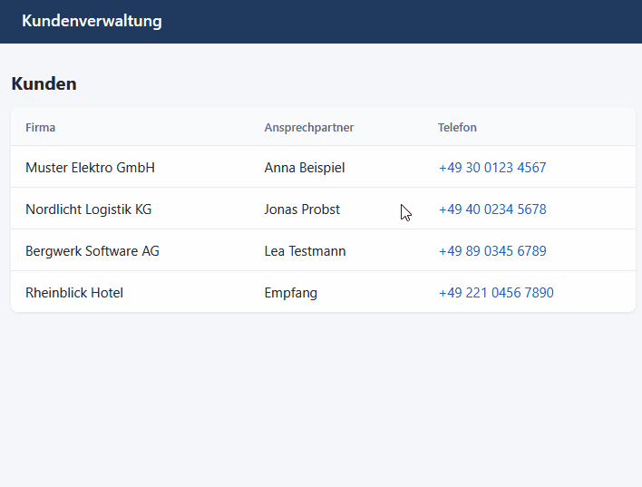

<div align="center">


# Click to Call

Telefonnummern am PC anklicken – das Snom- oder Yealink-Tischtelefon wählt.

[](https://github.com/julianfaatz/click-to-call/releases/latest)
[](https://github.com/julianfaatz/click-to-call/releases)

**Deutsch** · [English](README.en.md)



</div>

Die App steuert das Telefon direkt im lokalen Netzwerk – ohne Server und ohne Telefonanlagen-Software.

## Funktionen

- 📞 `tel:`-, `callto:`- und `sip:`-Links öffnen am Telefon (Browser, Outlook, CRM …)
- ⌨️ Nummer markieren und <kbd>Strg</kbd>+<kbd>Alt</kbd>+<kbd>W</kbd> drücken – funktioniert auch in PDFs und E-Mails
- Rufnummern werden aufbereitet: `+49 (0)30 123 456-78` → `03012345678`, optional mit Amtsholung
- Rückfrage vor dem Wählen, Auflegen-Taste, Wahlwiederholung, Auswahl der Leitung
- Findet das Telefon selbst im Netzwerk
- Läuft im Infobereich der Taskleiste, Updates per Klick
- Deutsch und Englisch


## Unterstützte Telefone

| Hersteller | Serien | Modelle (Beispiele) |
|---|---|---|
| **Snom** | D3xx, D7xx | D305, D315, D335, D345, D385, D713, D715, D717, D735, D785 |
| **Yealink** | T3x, T4x, T5x | T31, T33, T42, T43, T44, T46, T48, T53, T54, T57 |

Voraussetzung ist die HTTP-Fernsteuerung des Telefons: bei Snom über `command.htm`, bei Yealink über „Action URI“. Snom D8xx unterstützt diese Schnittstelle laut Hersteller nicht.

## Installation

1. **Herunterladen:** `ClickToCall-x.y.z-setup.exe` von [Releases](https://github.com/julianfaatz/click-to-call/releases/latest) starten. Windows 10/11, keine Admin-Rechte nötig. Auch als portable ZIP.
2. **Telefon verbinden:** Gefundenes Telefon anklicken oder IP-Adresse eingeben. Dann Benutzer und Passwort der Web-Oberfläche des Telefons eintragen.
3. **Links aktivieren:** In den Windows-Einstellungen bei **TEL** „Click to Call“ auswählen. Die Checkliste auf der Startseite führt dorthin.

> **SmartScreen-Warnung?** *Weitere Informationen → Trotzdem ausführen.* Der Installer ist nicht signiert, jedem Release liegen SHA-256-Prüfsummen bei.


<table>
  <tr>
    <td></td>
    <td></td>
  </tr>
</table>

## Aus anderen Programmen wählen

Andere Programme oder Skripte rufen die App einfach mit der Nummer auf:

```powershell
ClickToCall.exe "tel:+49301234567"
```

## Fehlersuche

| Problem | Lösung |
|---|---|
| Telefon wird nicht gefunden | IP-Adresse von Hand eingeben (steht im Telefonmenü unter *Informationen*). |
| „Benutzername oder Passwort falsch“ | Login der Web-Oberfläche verwenden, nicht die SIP-Daten. |
| „Das Telefon verweigert den Zugriff“ | Benutzer braucht Admin-Rechte, HTTP-Steuerung muss erlaubt sein. |
| Yealink wählt nicht | Beim ersten Anruf am Telefon „Fernsteuerung erlauben“ bestätigen. Oder PC-IP unter *Features → Remote Control* → **Action URI Allow IP List** eintragen. |
| Klick auf tel:-Link macht nichts | *Wählen → Links* aktivieren und in Windows „Click to Call“ für **TEL** auswählen. |
| Hotkey geht nicht | Unter *Wählen → Hotkey* eine andere Kombination wählen. |

Immer noch Probleme? In der App *Allgemein → Fehler melden* oder ein [Issue](https://github.com/julianfaatz/click-to-call/issues/new/choose) öffnen. Einstellungen und Protokoll liegen in `%APPDATA%\ClickToCall`.

## Datenschutz

- Verbindet sich nur mit dem Telefon und mit GitHub (Update-Suche, abschaltbar)
- Keine Telemetrie
- Telefon-Passwort wird verschlüsselt gespeichert (Windows DPAPI)

## Mitmachen

- Bauen, ohne Telefon testen, Releases: [CONTRIBUTING.md](CONTRIBUTING.md)
- Änderungen je Version: [Changelog](CHANGELOG.md)

## Lizenz

[MIT](LICENSE) © Julian Faatz

Kein offizielles Produkt von Snom oder Yealink. Snom und Yealink sind Marken ihrer jeweiligen Inhaber.
